<p align="center">
  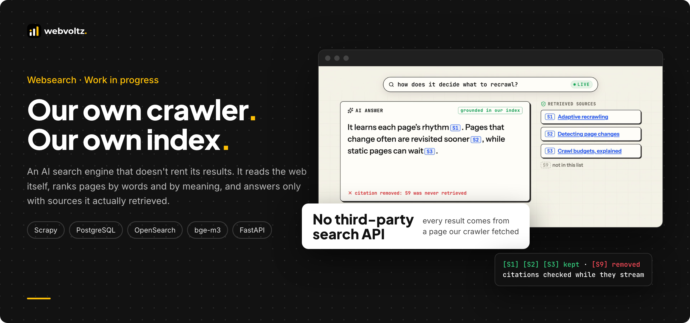
</p>

<p align="center">
  <a href="#what-we-built">What we built</a> ·
  <a href="#planned-vs-built">Planned vs built</a> ·
  <a href="ARCHITECTURE.md">Architecture</a> ·
  <a href="SECURITY-AND-QUALITY.md">Security and quality</a> ·
  <a href="#risks-and-how-we-handled-them">Risks</a> ·
  <a href="#screenshots">Screenshots</a> ·
  <a href="#walkthrough-video">Video</a>
</p>

---

## The outcome

Websearch is an independent web search engine with an AI answer layer on top. Discovery, crawling, the index and ranking are all ours. Every result comes from a page our own crawler fetched and read, and no third-party search API sits anywhere in the path.

- **Nothing rented.** We wrote the URL discovery, the crawler, the index and the ranking. Coverage is exactly what the crawler has fetched, and every ranking decision is ours to change.
- **Fresh where it matters.** Each URL learns how often it changes. Busy feeds are revisited quickly, and pages that never change are left alone, so the crawl budget goes where the news is.
- **Finds by meaning, and says why.** Keyword search and meaning-based search run side by side and are fused into one ranking. Every result carries an explanation of how it got its place.
- **Answers that can't cite what they didn't read.** The language model searches our index through a tool. Any citation to a source it wasn't given is removed while the answer streams.

> **Status: work in progress.** The crawl, index and retrieval core is built and tested, and so is a first answer layer (chat with a search tool and checked citations). A dedicated grounded-answers endpoint, a page-fetch tool, reranking in search and operating the engine at web scale are planned, not built. Every part of the plan and its status is in [Planned vs built](#planned-vs-built).

> This repository is a technical case study. It shows how we structure, write and ship this kind of system through selected excerpts, diagrams and an explainer animation. The full source is not published. See [Notice](#notice).

---

## The problem

Most AI products that "search the web" call someone else's search API. That makes the most important part of the product a dependency. Building our own means solving four problems at once:

1. **Rented results.** With a third-party API, coverage, ranking, freshness and cost all belong to someone else. You can't tune what you don't own, and you can't explain a ranking you didn't compute.
2. **Freshness without waste.** News pages change by the minute. Most pages never change at all. A fixed recrawl schedule either misses the news or spends its budget refetching pages that are the same as last time, and hits sites harder than it needs to.
3. **A crawler is an attack surface.** It fetches whatever the web points it at. A hostile link or redirect can try to steer it at internal services or a cloud metadata endpoint.
4. **Trusting the answer.** A language model answering from web pages can invent sources, or obey instructions hidden inside a page. An answer is only as useful as its citations are real.

---

## What we built

The engine is a back-end service with an HTTP API. It has no end-user interface yet, so the clips below come from an explainer animation we made for this project, not from screen recordings. Each clip shows a behaviour that exists in the code, and the text under it says exactly what is built.

### Pages we found and read ourselves

The crawler discovers URLs from seeds, robots.txt, sitemaps, RSS and Atom feeds, and links on the pages it reads. Every URL goes through the same steps: discover, fetch, read, index. robots.txt is always enforced, and politeness limits are shared by every worker, whichever crawl lane it serves.

<p align="center">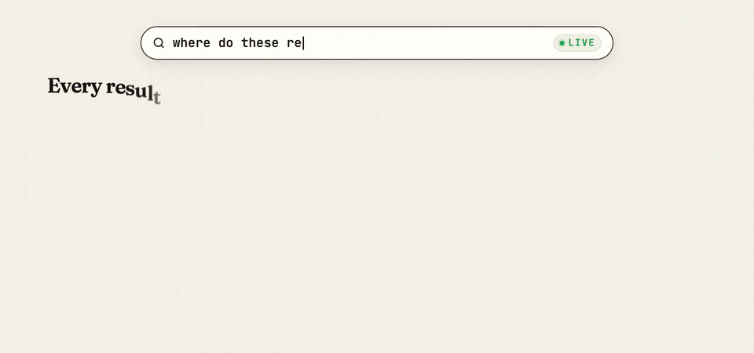</p>

### Freshness that adapts to each page

No URL has a fixed schedule. After each fetch, its interval shrinks if the content changed and grows if it didn't, and the interval places it in one of five crawl lanes, from `realtime` to `slow`. Sites get a tier from how much they actually publish, and the tier sets how often their pages may be fetched and how many the crawler keeps.

<p align="center">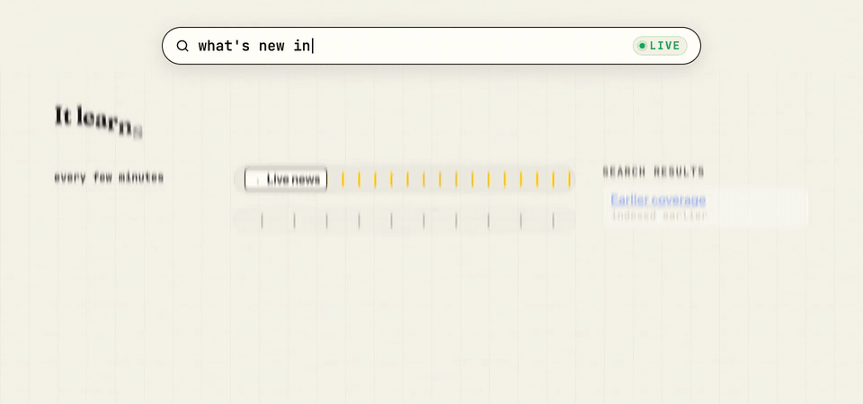</p>

### Spelling corrected from what's really in the index

When a query matches nothing by its words, the engine asks the index for similar words that occur in real pages, tries each candidate and searches the one with the most hits. A query that already has results is never "corrected". The fix comes from the corpus, not from a dictionary guess.

<p align="center">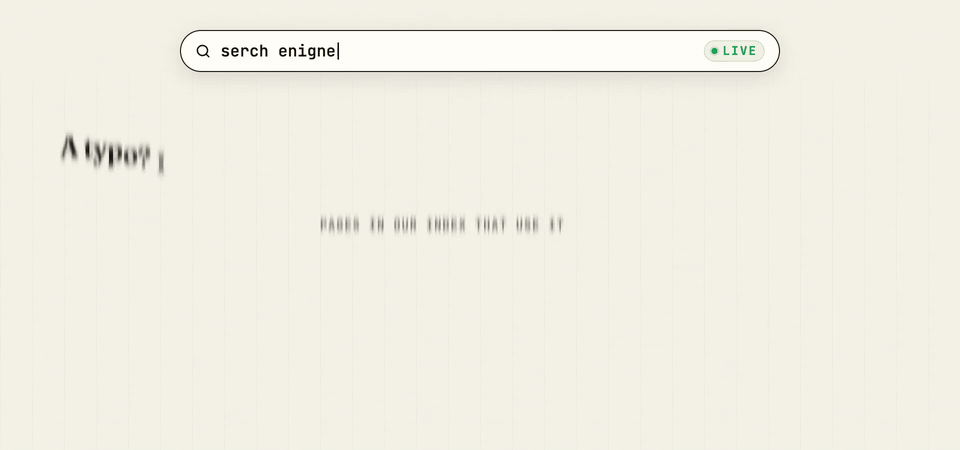</p>

### Search by meaning, down to the passage

Pages are also cut into passages and embedded. A second search leg matches the query's meaning against those passages, so a page can be found even when it uses different words, and the best passage is shown with the result. The two legs are fused by rank. If the meaning leg is slow or down, search answers from keywords alone.

<p align="center">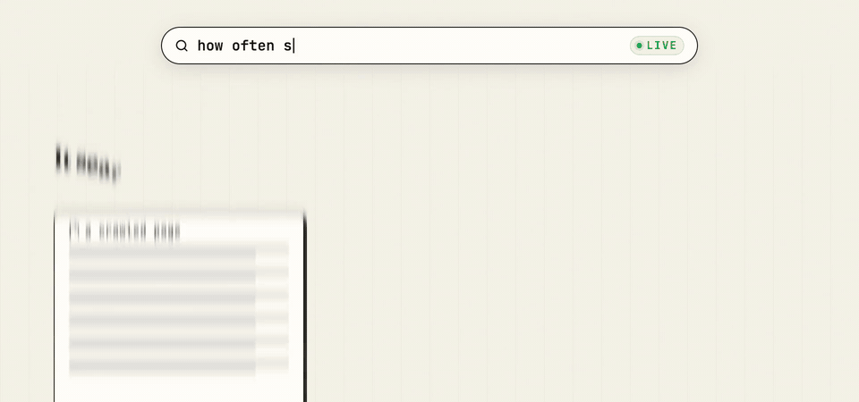</p>

### Answers that cite only what they retrieved

The chat endpoints give a language model one tool, `web_search`, over our own index. Every result it receives is registered as a source (`S1`, `S2`…) and framed as untrusted text. As the answer streams, citations to registered sources are kept, and anything else is removed.

<p align="center">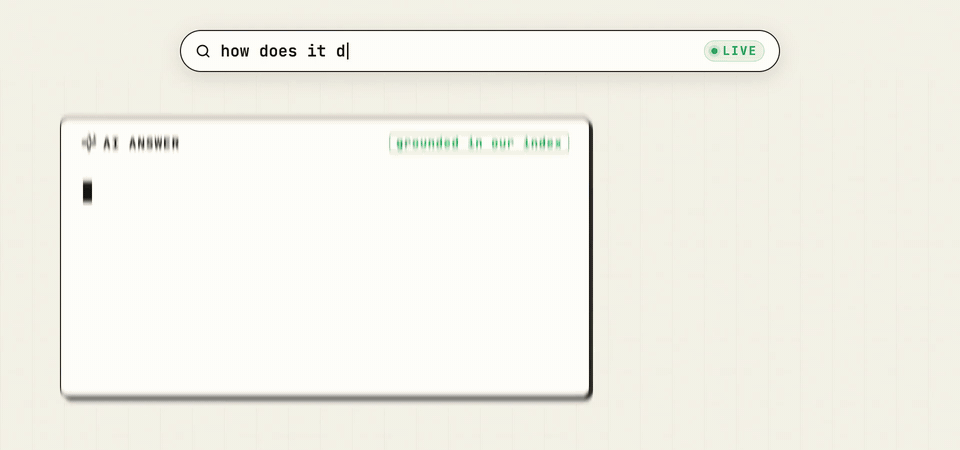</p>

### Open to agents, measured on every change

Search is a plain HTTP API, and the chat endpoints already use it as a tool, so other agents can call it the same way. Changes to search and ranking are checked against a set of hand-judged queries before they are accepted. The trend lines in this clip are illustrative, not measurements.

<p align="center">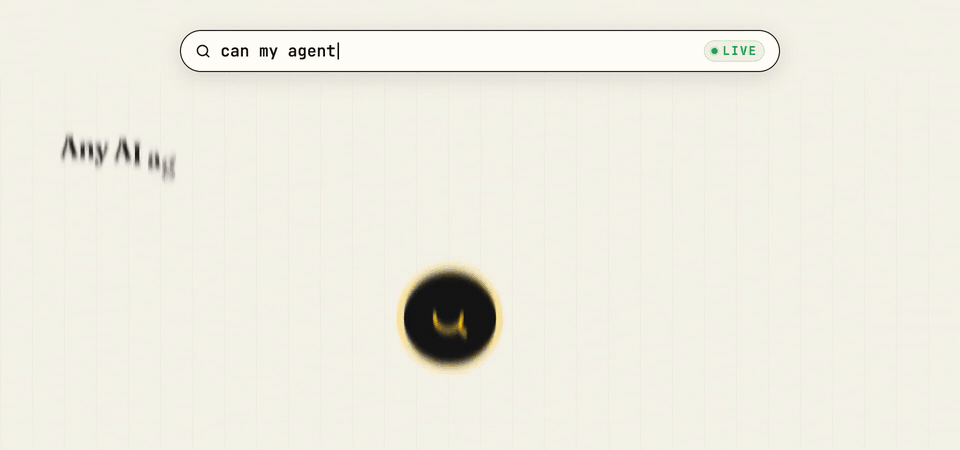</p>

---

## Planned vs built

<p align="center">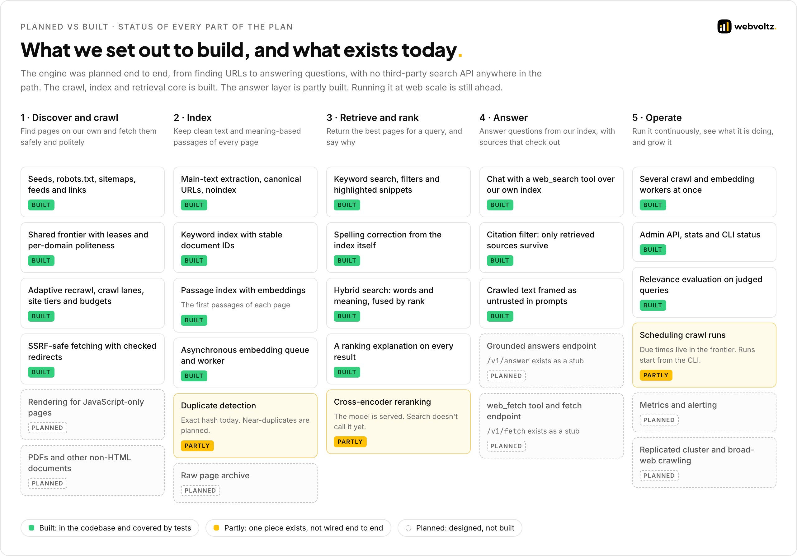</p>

**What we set out to build.** An independent AI search engine: our own URL discovery, crawler, index and retrieval, with a language model that answers from that index and cites what it used. It was designed to run continuously as a service, with scheduled crawl workers, rendering for JavaScript-heavy pages, a raw archive of fetched pages, a replicated search cluster and monitoring.

**What exists today.**

| Area | Built | Partly built | Planned |
| --- | --- | --- | --- |
| Discover and crawl | Seeds, robots.txt, sitemaps, feeds, links. A shared PostgreSQL frontier with leases and politeness. Adaptive recrawl, crawl lanes, site tiers and page budgets. SSRF-safe fetching. | | Rendering for JavaScript-only pages. PDFs and other non-HTML documents. |
| Index | Main-text extraction, trusted canonicals, `noindex`. A keyword index with stable IDs. A passage index with embeddings, filled by an asynchronous worker. | Duplicates: exact content hash only. | Near-duplicate detection. A raw page archive. |
| Retrieve and rank | Keyword search with filters and snippets. Spelling correction from the index. Hybrid search fused by rank. A ranking explanation on every result. | Reranking: the cross-encoder is served by our model server, but search doesn't call it yet. | |
| Answer | Two chat endpoints with a `web_search` tool over our index, a streaming citation filter, and untrusted-content framing. | | A grounded-answers endpoint (`/v1/answer`) and a `web_fetch` tool with `/v1/fetch`. Both exist as stubs that return 501. |
| Operate | Several crawl and embedding workers at once. An admin API, stats and CLI status. A relevance evaluation harness. | Scheduling: due times live in the frontier, but crawl runs are started from the CLI. | Metrics and alerting. A replicated cluster. Crawling the open web at scale. |

The engine has only been run on a development corpus so far. It has not been tested at web scale.

---

## At a glance

<p align="center">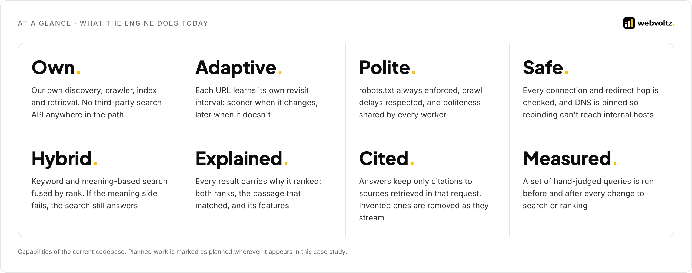</p>

This case study describes capabilities, not figures. The engine has only been run on a development corpus, and we don't quote performance or scale numbers that haven't been measured at a meaningful size.

---

## How it's engineered

<p align="center">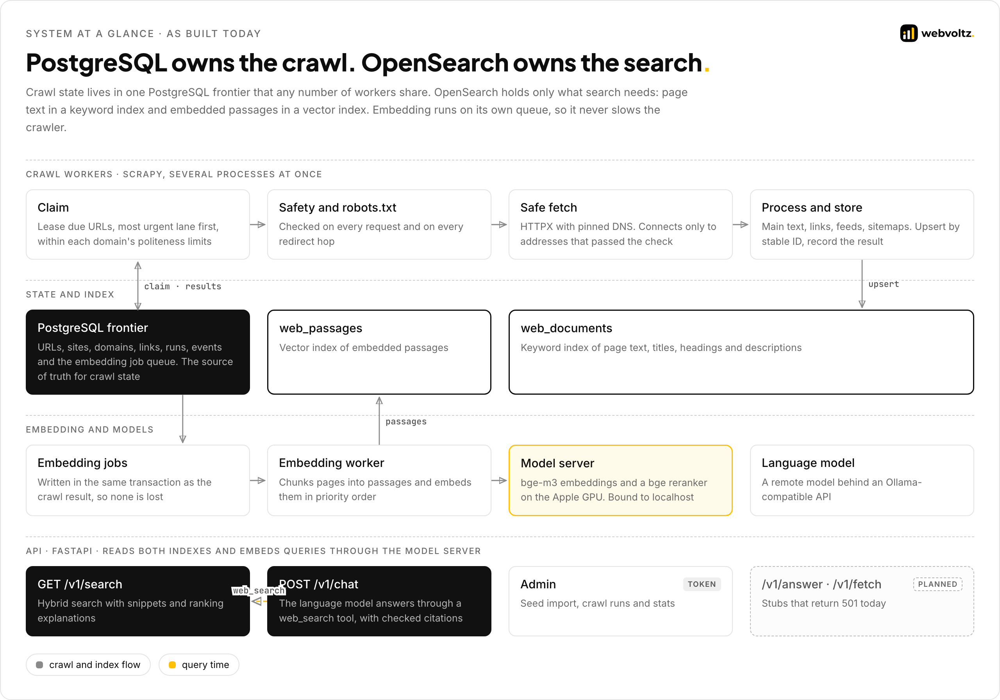</p>

| Area | Decision | Why |
| --- | --- | --- |
| Crawl state | PostgreSQL is the frontier and the source of truth. OpenSearch is only the index. | Leases, politeness, retries and the record of every fetch need transactions. A search index can be rebuilt from them. |
| Workers | Claims use `SKIP LOCKED` row locks, with leases that expire | Any number of workers share one queue without fetching a URL twice, and a crashed worker's URLs come back on their own. |
| Freshness | A per-URL interval that shrinks on change and grows when unchanged, mapped to crawl lanes | The crawl follows how each page actually behaves, and fast-changing pages never wait behind the long tail. |
| Safety | Two-layer SSRF checks with DNS pinned at connect time, applied to every redirect hop | Validation and connection use the same resolution, so DNS rebinding can't reach an internal address. |
| Retrieval | BM25 and k-NN over passages, fused with Reciprocal Rank Fusion | Rank fusion needs no score calibration, and either leg can surface a page the other missed. |
| Resilience | The meaning leg can never fail a search | The model server is a separate process. When it's down or slow, search returns keyword results with a warning. |
| Embedding | An asynchronous job queue, written in the crawl result's own transaction | Embedding never slows the crawler, and no job can be lost between the two. |
| Answers | A source registry and a streaming citation filter | A citation is valid only if it names a source returned in that request. |

The full write-up, with excerpts, is in **[ARCHITECTURE.md](ARCHITECTURE.md)**.

---

## Beyond what's built

*Not built. This section shows where the engine goes next and how the existing parts carry over.*

The project started from a target architecture for running the engine as a service. Most of its crawl and index path exists. What remains is mostly around it: scheduling, rendering, archiving, replication and monitoring.

<p align="center">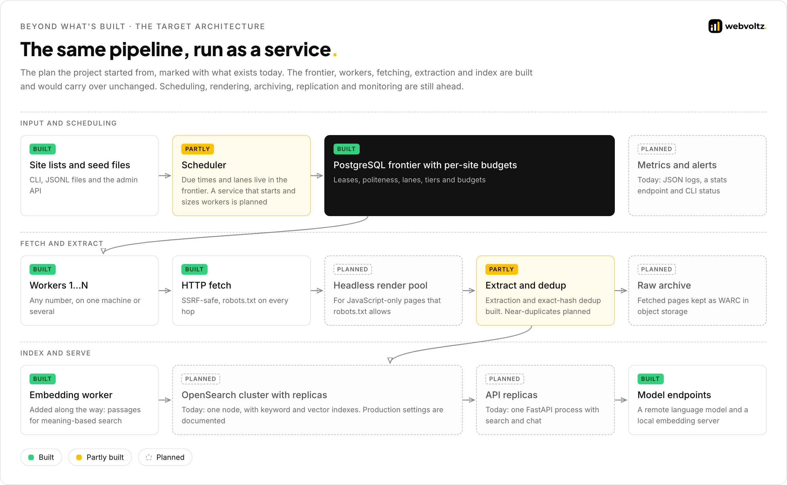</p>

- **Rerank the top results.** The cross-encoder already runs on our model server. Wiring it into search, and into the passages the answer layer reads, is the next ranking step.
- **A grounded-answers endpoint.** `/v1/answer` would return validated citations as structured output. The source registry and citation checks it needs already exist.
- **A safe fetch tool.** `web_fetch` and `/v1/fetch` would reuse the crawler's SSRF-safe fetcher and robots.txt rules, behind authentication, so the API can't be used as an open proxy.
- **Run it as a service.** A scheduler that starts and sizes workers, a render pool for JavaScript-only pages, a raw archive, replicas for OpenSearch and the API, and metrics with alerts.

---

## Engineering standards

<p align="center">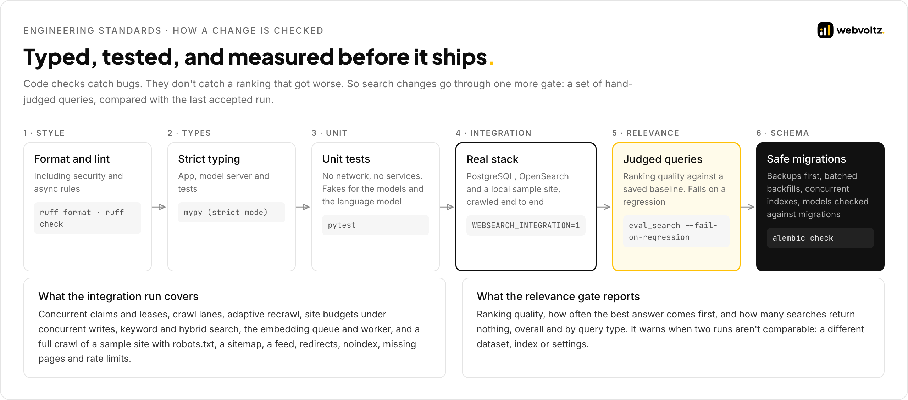</p>

- **Strictly typed.** The app, the model server and the tests are type-checked in strict mode. Lint rules include security and async checks.
- **Unit tests need nothing running.** No network and no services. The models and the language model are replaced by in-memory fakes.
- **Integration tests run the real stack.** PostgreSQL, OpenSearch and a local sample site, crawled end to end: robots.txt, sitemap, feed, redirects, `noindex`, missing pages, rate limits, search and the embedding worker.
- **Relevance is a gate, not a feeling.** A set of hand-judged queries runs before and after every change to search or ranking, and the run fails on a regression.
- **Migrations that don't lock production.** Backfills run in committed batches, indexes are built concurrently, and the models are checked against the migrations.

---

## Risks and how we handled them

| Risk | What could go wrong | How we handled it |
| --- | --- | --- |
| SSRF through a crawled link | The crawler is steered at an internal service or a cloud metadata endpoint | Two-layer checks on every request and redirect hop. DNS is resolved once and the connection goes to the vetted address. |
| Hammering a site | Several workers hit one domain at once | Politeness lives in the frontier: a per-domain concurrency cap and a next-allowed time that every claim moves forward |
| Wasted crawl budget | Unchanged pages are refetched while news goes stale | Adaptive intervals, crawl lanes, and site tiers with a recrawl floor and a page budget |
| A page that always "changes" | A clock or counter makes a page look changed on every fetch, so it's crawled constantly | The site tier's recrawl floor caps how often any of its URLs can be fetched |
| Lost work on a crash | A worker dies mid-fetch and its URLs are stuck | Leases expire and the URLs return to the queue. The crawl result and its embedding job commit together. |
| Search down with the model server | A model outage takes search with it | The meaning leg is optional per request. Keyword results come back with a `vector_unavailable` warning. |
| Invented citations | The model cites a source it never received | A streaming citation filter keeps only labels registered in that request |
| Prompt injection from pages | Crawled text tells the model what to do | Sources are wrapped as untrusted data, with an explicit instruction never to follow them |
| A ranking change makes results worse | A tweak helps one query and quietly hurts many | Hand-judged queries compared with a saved baseline before a change is accepted |

What the current build deliberately leaves out is listed in [Security and quality](SECURITY-AND-QUALITY.md#known-limits).

---

## Screenshots

Frames from the explainer animation. Each shows a behaviour of the current build.

<table>
  <tr>
    <td width="50%">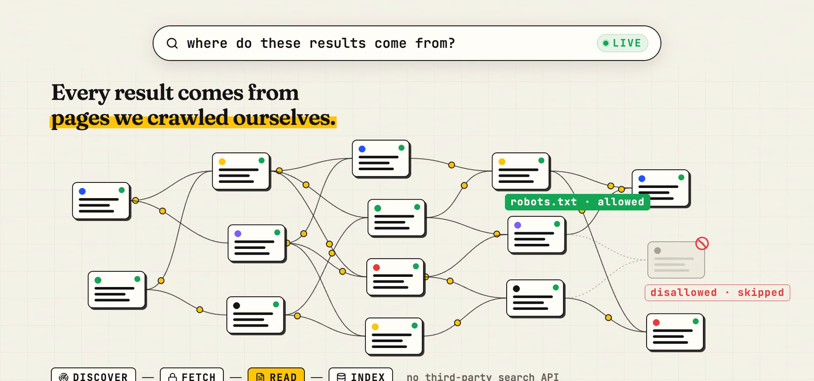</td>
    <td width="50%">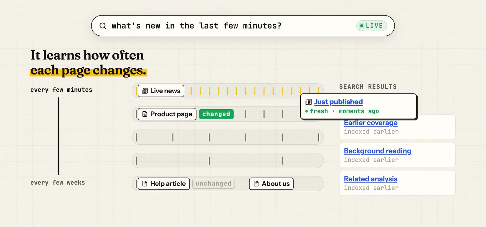</td>
  </tr>
  <tr>
    <td width="50%">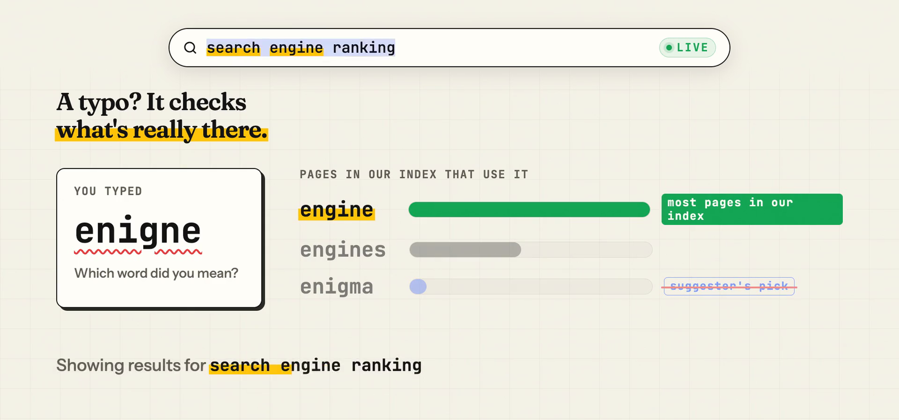</td>
    <td width="50%">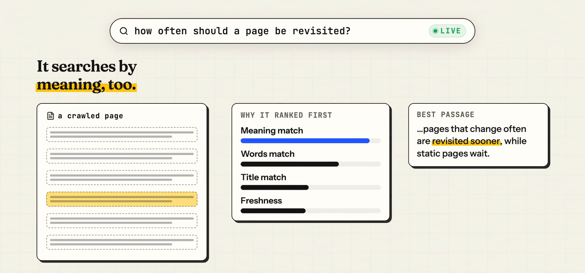</td>
  </tr>
  <tr>
    <td width="50%">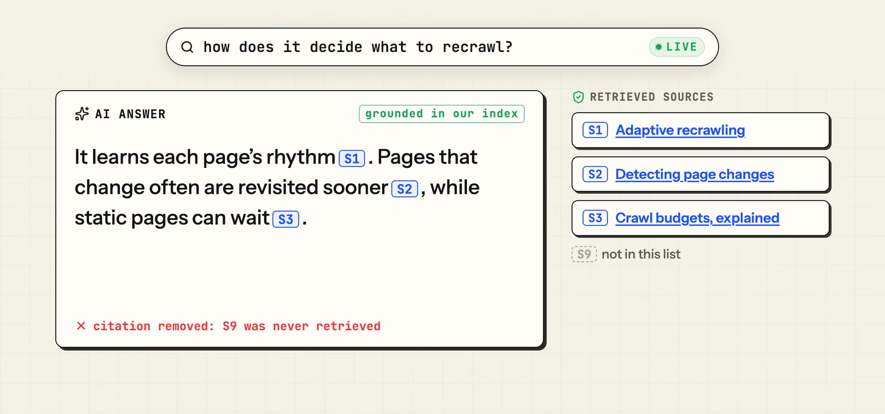</td>
    <td width="50%">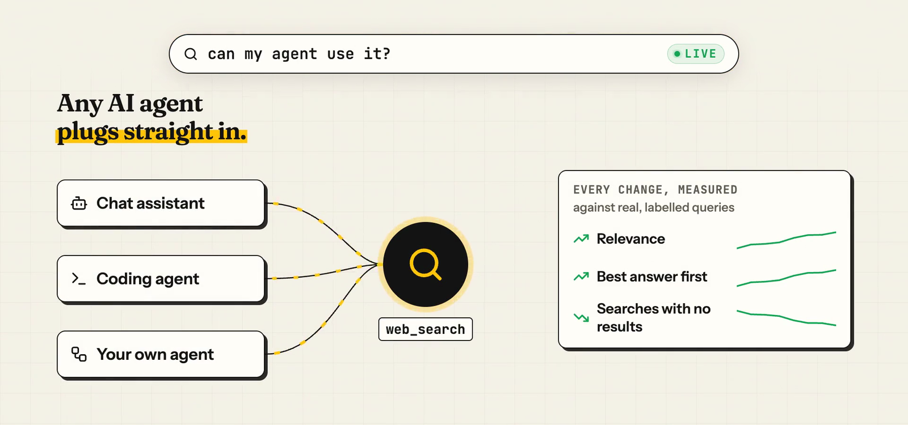</td>
  </tr>
</table>

---

## Repository map

```text
.
├── README.md                     this page
├── ARCHITECTURE.md               discovery, frontier, fetching, recrawl, retrieval, answers, what's next
├── SECURITY-AND-QUALITY.md       safety controls, how changes are checked, known limits
├── src/
│   ├── crawl/
│   │   ├── frontier.excerpt.py   claiming due URLs with SKIP LOCKED and per-domain politeness
│   │   ├── safety.excerpt.py     two-layer SSRF checks and the DNS-pinned connection
│   │   └── scheduling.excerpt.py adaptive recrawl intervals, crawl lanes and site tiers
│   └── search/
│       ├── hybrid.excerpt.py     the meaning leg and Reciprocal Rank Fusion
│       └── citations.excerpt.py  source registry, untrusted framing, streaming citation filter
├── assets/                       diagrams, GIFs, screenshots, brand
└── video/                        walkthrough video and thumbnail
```

---

## Tech stack

| Layer | Built | Planned |
| --- | --- | --- |
| Crawler | Scrapy, HTTPX with a DNS-pinned network backend, Protego for robots.txt, Trafilatura and lxml for extraction, tldextract for sites | A headless render pool for JavaScript-only pages |
| Crawl state | PostgreSQL 18, SQLAlchemy (async), asyncpg, Alembic | Same |
| Index | OpenSearch 3.9: a BM25 keyword index and a k-NN passage index | A replicated cluster |
| Models | A native model server on PyTorch (Apple GPU): bge-m3 embeddings and bge-reranker-v2-m3 | Reranking wired into search |
| Answers | A language model behind an Ollama-compatible API, with native or prompted tool calling | `/v1/answer` and a `web_fetch` tool |
| API | FastAPI and Uvicorn, Pydantic settings, JSON logs | API replicas |
| Quality | pytest, mypy in strict mode, Ruff, a relevance evaluation harness | Metrics and alerting |
| Delivery | uv, Docker Compose for the local stack | Same |

---

## Walkthrough video

A 65-second overview in plain language: why most AI tools rent someone else's search, how our crawler finds and reads pages while respecting each site's rules, how it learns how often each page changes, how it handles typos and searches by meaning, how answers cite only what was retrieved, and how any AI agent can plug in.

<p align="center"><a href="video/search.mp4">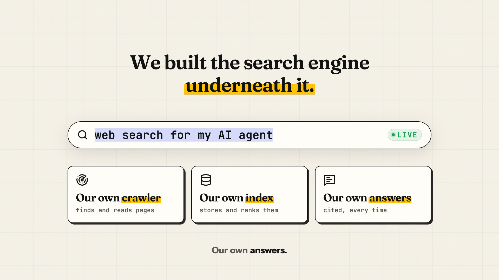</a></p>

<p align="center"><a href="video/search.mp4">Watch the walkthrough (1:05, 1080p)</a></p>

---

## About Webvoltz

Webvoltz builds the technology systems businesses compete, operate and scale on: web platforms, product engineering, automation, integrations and managed delivery teams. One accountable partner from first strategy session to ongoing delivery.

[**Book a strategy call**](https://webvoltz.com) to talk through search engines, retrieval for AI, or crawling and indexing your own data.

---

## Notice

Copyright © 2026 Webvoltz. All rights reserved.

This repository is published for viewing and evaluation only. The code excerpts, designs, diagrams and animations may not be copied, modified, redistributed or used in other work without written permission. See [`NOTICE.md`](NOTICE.md).
